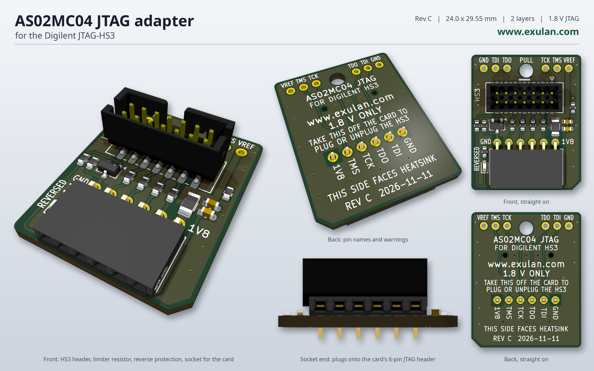
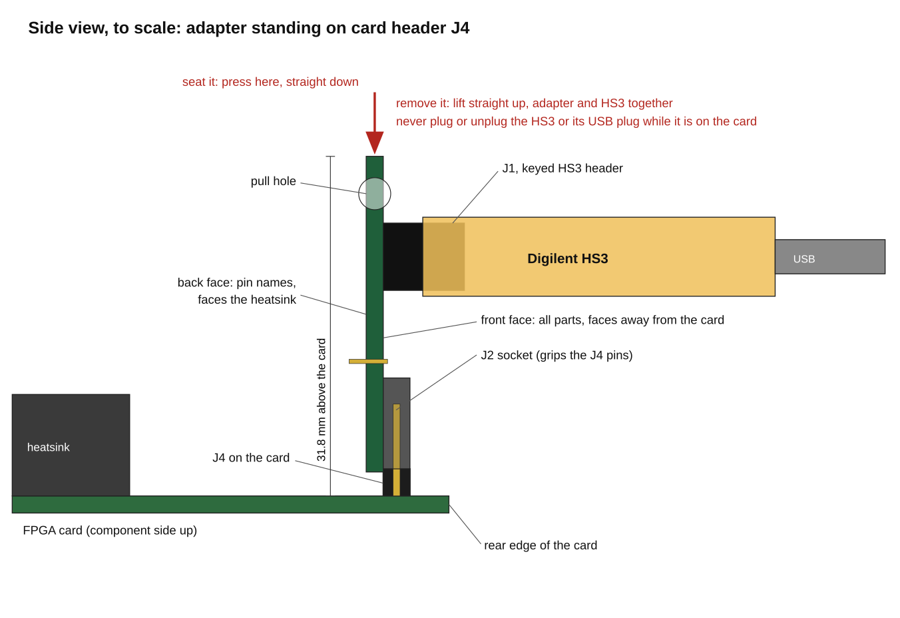
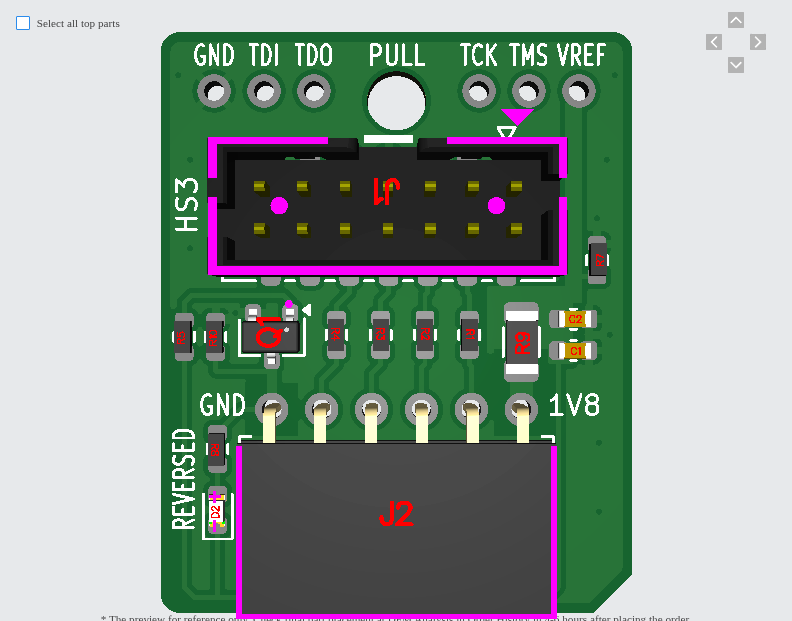

# AS02MC04 JTAG adapter for the Digilent JTAG-HS3

A small board that lets a Digilent JTAG-HS3 plug straight onto the 6-pin JTAG header (J4)
of the Alibaba Cloud AS02MC04 FPGA card (label PN YZQT-02337-101, Xilinx Kintex UltraScale+ XCKU3P).



> **Status, 2026-11-13:** the first five boards are on order from JLCPCB and have not arrived.
> Nothing here has been tested on real hardware yet. Write-up:
> <https://www.exulan.com/blog/2026-11-13-as02mc04-jtag-adapter>

The HS3 has a 2x7, 2.00 mm Xilinx plug. The card has a 1x6, 2.54 mm pin header with a different
pin order and no keying. This board converts one to the other, takes the HS3's reference voltage
from the card's own 1V8 pin, and survives being plugged on the wrong way round.

| | |
|---|---|
| Revision | C, 2026-11-11 |
| Board | 24.0 x 29.55 mm, 2 layers, 1.6 mm, all parts on one side |
| Made by | JLCPCB, economic assembly, arrives ready to use (no soldering) |
| Card side | J2, right-angle 1x6 socket on the bottom edge, plugs onto J4 |
| Probe side | J1, keyed and shrouded Molex 87832-1420, the header the HS3 is made for |
| JTAG voltage | 1.8 V only, taken from the card |

## How it sits on the card



The adapter stands upright on J4. The side with the parts (front) points away from the card,
past its rear edge, and so does the HS3. The side with the pin names (back) faces the heatsink.

J4 is at the rear end of the card (the end away from the bracket), on the heatsink side. Seen from
that side with the rear edge toward you, the card's silkscreen reads `GND TDI TDO TDK TMS 1`, with
`1V8` printed sideways next to pin 1. `TDK` is the card's spelling of TCK.

Space needed: the top of the adapter is about 32 mm above the card, and the HS3 sticks out roughly
35 mm past the card's rear edge, plus the USB plug and the bend of its cable.

## Pin map

| HS3 / J1 pin | Signal | Through | J2 pin | Card J4 pin | Card silkscreen |
|---|---|---|---|---|---|
| 2 | VREF (HS3 buffer supply) | R9, 4.7 ohm 0.75 W | 1 | 1 | 1V8 |
| 4 | TMS | R1, 22 ohm | 2 | 2 | TMS |
| 6 | TCK | R2, 22 ohm | 3 | 3 | TDK |
| 8 | TDO (card to HS3) | R3, 22 ohm | 4 | 4 | TDO |
| 10 | TDI | R4, 22 ohm | 5 | 5 | TDI |
| 1, 3, 5, 7, 9, 11, 13 | GND | Q1 (reverse protection) | 6 | 6 | GND |
| 12, 14 | not connected | | | | |

## Check the connector pitch first

`docs/pitch_gauge.pdf` is a 1:1 print sheet for both connectors. Print it at 100 %, check the
100 mm bar with a ruler, then hold the card header against rows A and B and the HS3 plug against
patterns C and D. The adapter is built for row A (2.54 mm) and pattern C (2.00 mm).
Checked against the real card and HS3 on 2026-11-11: both match.

## Ordering from JLCPCB

Everything JLCPCB needs is in `fab/`:

| File | Used for |
|---|---|
| `fab/as02mc04_jtag_hs3-gerbers.zip` | the bare board |
| `fab/as02mc04_jtag_hs3-bom.csv` | assembly: bill of materials with LCSC part numbers |
| `fab/as02mc04_jtag_hs3-cpl.csv` | assembly: where each part goes |

1. On jlcpcb.com start a PCB order and upload `as02mc04_jtag_hs3-gerbers.zip`. It should detect a
   2-layer board of 24 x 29.55 mm.
2. Board options (names as on JLCPCB's form in November 2026). Leave everything else as it is.

   | Option | Choose |
   |---|---|
   | Base Material, Layers | FR-4, 2 |
   | PCB Qty, Delivery Format | 5, Single PCB |
   | PCB Thickness, Outer Copper Weight | 1.6mm, 1 oz |
   | PCB Color, Silkscreen | Green (any colour works), White |
   | Surface Finish | LeadFree HASL, or HASL(with lead). Not OSP, which the form may preselect |
   | Via Covering | Tented |
   | Board Outline Tolerance | ±0.2mm (Regular). The precision option needs a board of at least 50 x 50 mm |
   | Mark on PCB | Remove Mark |
   | PCB Build Time | the line that shows A$0.00 (2 days; with assembly on, the form picks "24 hours, PCBA Only" itself) |

   Do not click the "High Precision PCB" layer counts: that is JLCPCB's product for boards of 6 or
   more layers. If you did, reload the page, because it can leave an expensive filled-via option on.
3. Turn on PCB Assembly: PCBA Type "Economic", Assembly Side "Top Side", Tooling holes "Added by
   JLCPCB", Parts Selection "By Customer". For PCBA Qty choose 5 or 2 (the rest arrive as bare
   boards with no parts). Set "Confirm Parts Placement" to Yes and, in the box that pops up, tick
   "Do not confirm automatically": otherwise JLCPCB approves its own placement drawing for you
   after 72 hours. With it ticked, the order waits until you have looked at the drawing.
4. Upload the BOM and CPL files. All 12 lines should match a part and show stock. Four lines are
   marked as extended-library parts (J1, J2, Q1, R9). The three surface mount ones (J1, Q1, R9)
   carry a one-off loading fee each. J2 is a through-hole part that JLCPCB fits and solders by
   hand, for a labour fee and a charge per joint.
5. In the placement preview, check these before paying:
   * **J1** (the big black header): the gap in its wall (the key slot) must be on the side toward
     the 3 mm hole and the small test holes, next to the white bar printed on the board.
     If JLCPCB shows it turned half a turn, rotate it by 180 degrees in the preview. This is the one
     orientation the pad pattern cannot show, and it matters: a header fitted backwards would short
     the HS3's ground pins to the 1.8 V line.
   * **J2** (the socket): its body must lie over the large empty area, with the openings at the
     board edge that has the cut-off corner. It must not point up toward J1.
   * **Q1**: the side with one leg points toward J2, the side with two legs toward J1.
   * **D2**: the marked (cathode) end points toward the bottom edge, away from R8.

   This is what JLCPCB's preview showed for these files on 2026-11-11. The pink triangle marks pin 1
   of J1, the pink dot pin 1 of Q1, and the pink plus the anode of D2:

   

6. In the assembly options, under Advanced Options, set "Assembly remark" to Yes and paste this:

   > J1 (C492354): keep the rotation from the CPL. The key slot of the shroud faces the board edge
   > with the 3 mm hole. Do not turn it by 180 degrees.
   > J2 (C54876735): symmetric 1x6 right-angle socket with no polarity. Its body lies on the board
   > with the openings at the edge that has the chamfered corner. Do not rotate it.
   > If you add rails or mouse-bite tabs, keep them off the J2 edge (the edge with the chamfered corner).

Cost: on 2026-11-11 JLCPCB's order page quoted A$58.29 for 5 boards with all 5 assembled
(lead-free finish, placement confirmation on), before shipping and tax. That is A$7.40 for the
boards and A$50.89 for assembly, of which A$14.76 is parts and the rest fees. DHL Express was
estimated at A$31.03 on top. Most of the fees are fixed, so assembling only 2 saves little. The
quote on the order page on the day is the real number.

The boards may arrive joined to a break-off rail that JLCPCB adds for its machines. Snap it off
and file the edge smooth, or pay for "Depanel boards & edge rail before delivery" in the assembly
options (JLCPCB's form says it adds a day). To snap a rail off, grip the rail with flat pliers
right beside the board and bend the rail, not the board: C1 and C2 sit close to the right-hand
edge, and ceramic capacitors can crack when the board under them flexes.

If J2 is out of stock, these are the same kind of socket (8.5 mm body, 2.54 mm pitch): C55629861,
C2932681, C22436147. Compare the datasheet with the J2 footprint before swapping, and change the
LCSC number in the BOM file.

## Before first use

1. Look at J1. The slot in its wall must be on the same side as the white bar printed next to it
   (toward the test holes). If it is on the other side, do not use the board.
2. Look at D2, the small LED next to the word `REVERSED` (a magnifier helps). The small green mark
   on its top face must be at the end toward the bottom edge (the edge the socket opens onto). If
   the mark is at the other end, the LED was fitted backwards. The adapter still works, but the
   light then means the opposite of what this guide says, so ignore it on that board.
3. Look at the bottom edge. If the factory left a small nub of board material there, file it flat.
4. With a multimeter on resistance, and the adapter not plugged into anything, check the two
   hand-soldered socket pins where a solder bridge to the ground copper would bypass a protection.
   The pins are the solder points on the back, labelled `1V8` and `GND`. Two different points
   carry the name `GND`: the `GND` solder pin at the socket is the card's ground, and the `GND`
   test hole on the top edge is the adapter's own ground behind Q1.
   * red lead on the `1V8` solder pin, black on the `GND` test hole: settles at about 10 kilohm.
   * `1V8` solder pin to the `GND` solder pin: anything from a few kilohm to about a megohm,
     depending on the meter and which way round the leads are.
   * `GND` solder pin to the `GND` test hole: a few hundred ohms to about a megohm, depending on
     the meter and the lead direction, because Q1 has a diode inside that conducts one way.

   A reading under 100 ohm on any of the three means a solder bridge or a faulty part. Do not use
   that board.
5. With the card powered and nothing connected to J4, measure the card's pin 1 (`1V8`) against its
   `GND` pin. Expect about 1.8 V.
6. The pin at the `1V8` end of J4 on some cards is slightly bent. Straighten it gently so all six
   pins are in line.

## Using it

The one rule that protects the card: **take the adapter off the card to plug or unplug the HS3,
and to plug or unplug the USB cable at the HS3.** J4 is a surface-mount header held by six small
solder joints, and the HS3 on the adapter is a long lever. Its micro-USB socket is at the far end,
in line with the plug, so pushing or pulling a plug at either end of the HS3 pushes sideways on
J4. The reminder printed on the back of the board names only the HS3; treat its USB socket the
same way. While the adapter is on the card, connect and disconnect the USB cable at the PC end
only.

### Plugged straight onto the card (bench or riser)

1. Switch the card off and touch the PC case or another grounded metal part first. The test
   holes on the top edge and the solder pins on the back connect straight to FPGA pins, so hold the
   adapter by its side edges. (The adapter tolerates being plugged onto a powered card, but
   switched off is safer: a slip cannot short two live pins.)
2. Plug the HS3 into the adapter, with the adapter lying flat on the bench. The HS3 only goes in
   one way. Plug the micro-USB cable into the HS3 now as well, and leave its other end free.
3. Hold the adapter with the HS3 pointing away from the card and lower it onto J4. The `GND` end of
   the adapter goes on the card's `GND` pin and the cut-off `1V8` corner on the card's `1V8` pin.
   Support the card from below near J4 with your other hand, or rest that end of the card on the
   bench. Press on the top edge of the adapter, straight down, until it stops. The socket can stop
   a fraction of a millimetre above the plastic base of the header, because the board edge reaches
   slightly past the socket. That is fine: do not force it further.
   Look from the side and count: all six pins must be in the socket, none left over at either end.
4. Plug the free end of the USB cable into the PC, then switch the card on. Fix the USB cable to
   the bench or the case close to the HS3 and leave a little slack, so a pull on the cable never
   reaches the card.
5. To remove: switch off, unplug the USB cable at the PC, then lift the adapter and the HS3
   together, straight up (a loop of cord through the pull hole helps). Separate them, and the
   micro-USB plug, on the bench.

Never let the HS3 hang by its cable.

### With a jumper cable (inside a PC, or when space is tight)

Use a 6-way male-to-female 2.54 mm jumper cable, 20 cm or shorter. The male ends go into J2, the
female ends onto J4, in the same order, so `1V8` meets `1V8` and `GND` meets `GND`. A cable with a
single 1x6 housing at each end is the easiest to get right. This is also the better choice for
anything longer than a quick session, because nothing heavy hangs on J4.

Wire it with the card switched off, and check every wire against the labels before switching on.
The reverse protection covers the whole 6-way connection turned end for end. It does not cover
single wires that are crossed. The one dangerous mix-up is the adapter's `GND` wire on the card's
`1V8` pin while the adapter's `1V8` wire sits on a signal pin. If the HS3 is then on a PC that
shares its ground with the card, the signal pin's weak pull-up can turn Q1 partly on, and Q1
passes current from the card's 1.8 V rail into the USB ground: a few tens of milliamps with a
typical part, up to about an amp in the worst case (a simulation, not a measurement). A single
1x6 housing at each end rules this out.

### Software

Use 15 MHz or lower when plugged straight on, and 6 MHz with a jumper cable. Do not use the HS3's
30 MHz setting: the timing of the HS3 and the FPGA together does not guarantee it. If the device
is found only sometimes, go lower (3 MHz, then 1 MHz).

In Vivado the HS3 opens at 15 MHz by default. To set 6 MHz:

```tcl
open_hw_manager
connect_hw_server
current_hw_target [get_hw_targets */xilinx_tcf/Digilent/*]
set_property PARAM.FREQUENCY 6000000 [current_hw_target]
open_hw_target
```

With openFPGALoader:

```bash
openFPGALoader -c digilent_hs3 --freq 6000000 --detect
```

The chain holds one device: XCKU3P, IDCODE 0x04A63093. Seeing that IDCODE is the real "it works"
indicator.

## If it does not work

| What you see | Likely cause |
|---|---|
| Red light next to `REVERSED` is on, no device found | The 6-pin connection is reversed. Nothing is damaged. Turn it round. |
| No device found, no light | Card not powered, socket one pin off, or reversed (the light is dim and can be missed). |
| Red light is on, but the device is found | D2 was fitted backwards at the factory (see "Before first use"). Ignore the light on that board. |
| Device found only sometimes | Lower the JTAG clock, shorten the cable. |

The red light is a best effort: it runs from 1.8 V, which is barely enough for a red LED, so it
is dim and on some boards may not be visible at all. No light is not proof that the orientation
is right.

To check the supply, measure between the test holes `VREF` and `GND` with everything connected and
the card on. Expect a reading within about 0.1 V of the card's own `1V8` pin, so 1.70 V or more on
a 1.8 V rail. If it reads under 1.65 V, the HS3 is below its minimum: check the card's `1V8` pin
and lower the JTAG clock, since the HS3 draws more at higher clock rates. If it reads about half a
volt low while the card's own pin is fine, Q1 is not switching on and that board is faulty.

## What the parts do

* **R9 (4.7 ohm, 0.75 W)** sits between the card's 1V8 pin and everything else on the adapter.
  Whatever goes wrong behind it, the card's 1.8 V rail cannot be shorted hard: the most that can
  flow is about 0.38 A. In a dead short R9 turns about 0.7 W into heat. It is a 0.75 W part, so
  it runs hot instead of burning out: a thermal model (not a measurement) gives roughly 105 to
  145 C at room temperature against a limit of 155 C, and more at the top of the 1.8 V tolerance or
  inside a warm case, where it can pass that limit. Do not leave a fault connected. The only
  copper ahead of R9 is socket pin 1, a 2 mm link and R9's own input pad.
* **Q1** is a MOSFET in the ground wire. It only conducts when 1.8 V arrives on the correct pin.
  If the 6-pin connection is reversed, the card's 1.8 V would otherwise be shorted to PC ground
  through the HS3's USB cable. Q1 blocks that. **R5** feeds its gate and **R10** bleeds static
  across it.
* The ground copper is kept 0.5 mm back from the two socket pins that matter most, `1V8` and
  `GND`, on both faces. A solder bridge from one of them to the ground copper would bypass R9 or
  Q1, which is what the meter check under "Before first use" looks for.
* **R1 to R4 (22 ohm)** are series resistors on the four JTAG signals. The HS3 already has
  100 ohm inside, so these mostly give a place to probe, cut or change a line.
* **C1, C2** decouple the HS3's buffer supply. **R7** (10 kilohm) discharges them when unplugged
  and holds the gate of Q1 low whenever the 1.8 V is absent.
* **D2 and R8** are the reversed-connection light.
* **Test holes** on the top edge (`GND TDI TDO`, then `TCK TMS VREF`) are for a scope or logic
  analyzer. Each group takes a 3-pin 2.54 mm header if you want to solder one in. They are not a
  second card port: `VREF` is the 1.8 V after R9 and `GND` is the adapter ground after Q1.
* The **pull hole** takes a loop of cord for lifting the adapter straight off the header.

## Limits

* 1.8 V JTAG only. The FPGA's configuration bank must not see more than 2.35 V.
* The card must be powered through its PCIe connector (slot or powered riser) for JTAG to work.
* Standing on the card the adapter is about 32 mm tall and the HS3 points out past the rear edge,
  so it will not fit next to a neighbouring card or a drive cage. Use the cable there.
* The reverse protection covers the 6-pin connection turned round. It does not notice a socket
  that is one pin off to the side, so count the pins when seating it, and it does not cover
  single crossed wires in a jumper cable (see "With a jumper cable"). It was worked out for the
  HS3, whose signal pins have no clamp to its Vref pin. Do not assume it holds for another probe.
* Nothing protects against a J1 header that the factory fitted backwards. That is what the checks
  in the placement preview and under "Before first use" are for.

## Rebuilding the design

The KiCad 10 project is in `hw/`. It is generated from one netlist file, `tools/design.py`, so the
schematic and the board cannot disagree.

The scripts need KiCad 10 (for `kicad-cli` and the `pcbnew` Python module) and a virtual
environment in `.venv` that can see the system packages:

```bash
python -m venv --system-site-packages .venv
```

```bash
.venv/bin/pip install sexpdata pillow
```

```bash
tools/build.sh
```

regenerates the schematic and board and runs KiCad's electrical and design rule checks plus the
project's own checks: the netlist against `design.py`, the physical pin order and pitch of both
connectors, the position of the socket at the board edge, the ground copper held back from the
two critical socket pins, the silkscreen against JLCPCB's printing limits (1.0 mm characters,
0.15 mm lines, no text on a pad, a hole or an edge), and every label against the net it sits
beside.

```bash
tools/fab.sh
```

exports the JLCPCB files and verifies them (drill counts, outline, and each part's rotation against
JLCPCB's own footprint).

```bash
tools/render.sh
```

redraws the layout plots, the 3D renders and the showcase picture in `docs/img/`, and
`docs/schematic.pdf`. The side view `docs/img/how_it_sits.png` comes from
`.venv/bin/python tools/gen_diagram.py`.

```bash
.venv/bin/python tools/gen_gauge.py
```

redraws the pitch gauge sheet.

## Licence

The design is released under the CERN Open Hardware Licence Version 2, Permissive
(CERN-OHL-P v2), see `LICENSE`. The footprints, symbols and 3D models in `hw/lib/jlc.*` were
converted from the EasyEDA/LCSC part library with easyeda2kicad and remain subject to their
original terms.

The design was produced by Claude (Anthropic) working with the owner of this repository.
